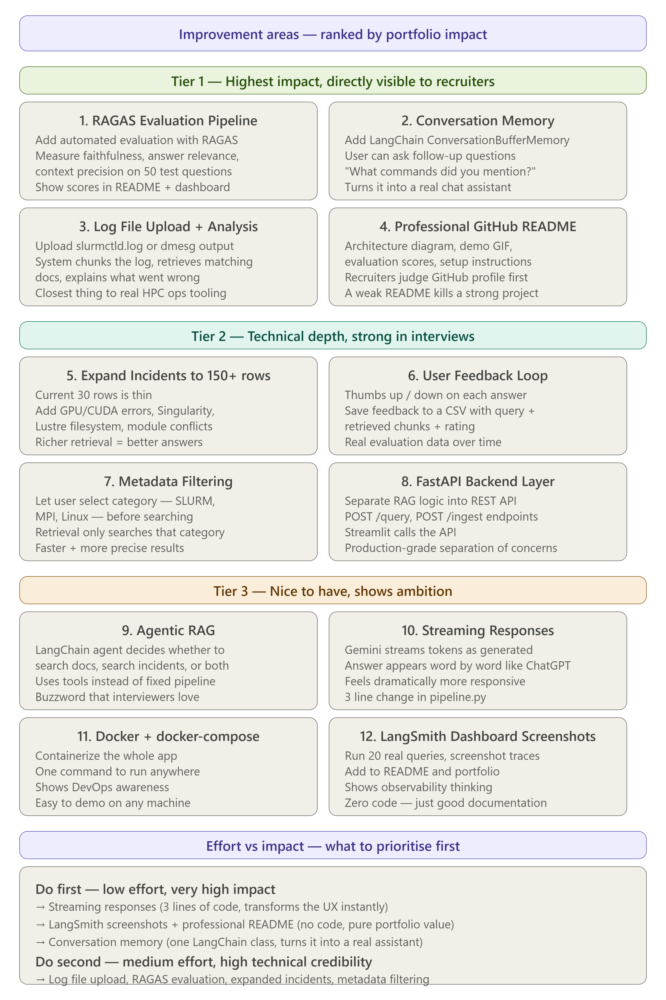

<div align="center">
  <h1>🖥️ HPC RAG Assistant</h1>
  <p><i>A Powerful RAG-based Conversational Agent for High-Performance Computing</i></p>

  <p>
    
    
    
    
  </p>
</div>

---

## 📖 Overview

**HPC RAG Assistant** is an intelligent, retrieval-augmented generation (RAG) conversational agent designed to help users troubleshoot and navigate High-Performance Computing (HPC) environments. It leverages cutting-edge NLP technologies to deliver accurate, context-aware answers based on HPC documentation.

## ✨ Features

- **🧠 Advanced RAG Pipeline**: Combines dense vector retrieval (FAISS) with sparse retrieval (BM25) for high-accuracy document fetching.
- **💬 Conversational UI**: A sleek, dark-themed, and responsive chat interface built with Streamlit.
- **⚡ Fast API Backend**: Robust and scalable FastAPI backend to handle search and inference requests.
- **🤖 Powered by LLMs**: Integrates with Google GenAI / HuggingFace models via LangChain to generate human-like, helpful responses.
- **📚 Context-Aware**: Maintains conversation history for seamless follow-up questions and debugging.

## 🛠️ Tech Stack

- **Frontend**: [Streamlit](https://streamlit.io/)
- **Backend**: [FastAPI](https://fastapi.tiangolo.com/), [Uvicorn](https://www.uvicorn.org/)
- **Orchestration**: [LangChain](https://python.langchain.com/)
- **Vector Store & Search**: [FAISS](https://github.com/facebookresearch/faiss), `rank-bm25`
- **Embeddings**: `sentence-transformers`
- **LLM**: Google GenAI (`langchain-google-genai`)

## 🚀 Getting Started

### Prerequisites

Ensure you have Python 3.9+ installed on your system.

### 1. Clone the Repository

```bash
git clone https://github.com/adharsh2006/RAG-based-trouble-shooting-assistant.git
cd RAG-based-trouble-shooting-assistant
```

### 2. Install Dependencies

Install the required Python packages using `pip`:

```bash
pip install -r requirements.txt
```

### 3. Environment Variables

Create a `.env` file in the root directory and add your API keys:

```env
GOOGLE_API_KEY=your_google_genai_api_key_here
```

### 4. Running the Application

You can run the Streamlit frontend application using:

```bash
streamlit run app.py
```

To run the FastAPI backend server (if required separately):

```bash
uvicorn server:app --reload
```

## 📸 Screenshots / Architecture
*(Add your architecture diagram or UI screenshots here, e.g., ``)*

<div align="center">
  
</div>

## 🤝 Contributing

Contributions are welcome! Please feel free to submit a Pull Request or open an issue if you encounter any problems or have suggestions.

## 📝 License

This project is licensed under the MIT License.
